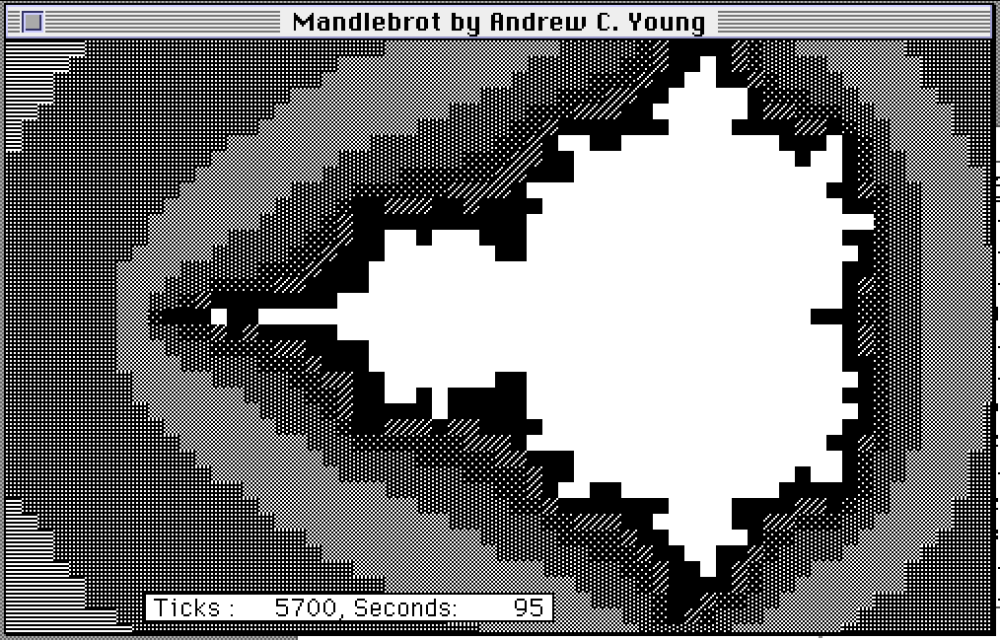

### Mandlebrot for Classic Macs

- mandlebrot.p - This is the source code for a Pascal implementation.
- mandlebrot.img - This is a disk image containing the compiled binary for the Pascal implementation. It should work on System 6+.

### Mandlebrot for Modern Macs

- [native](native) - Interactive Swift/AppKit app for Apple Silicon Macs, with pan and zoom.
